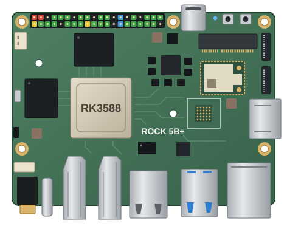
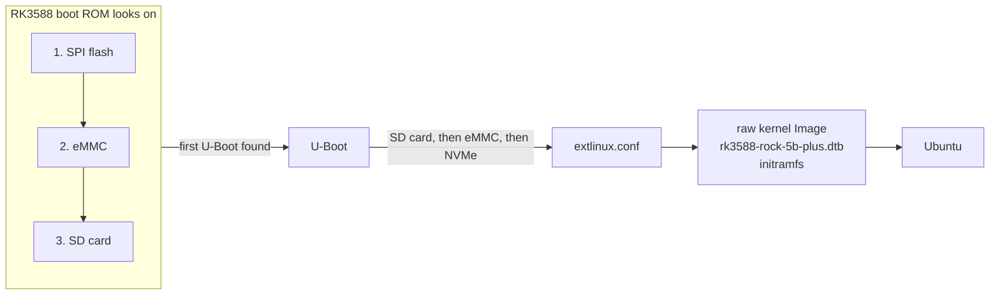

<a name="readme-top"></a>

<div align="center">



# Ubuntu for the ROCK 5B+

_Ubuntu images for one board, and only that one: the Radxa ROCK 5B+._

[Install](#install) • [Usage](#usage) • [How it works](#how-it-works) • [Releases](https://github.com/vant0m/ubuntu-rockchip-rock-5-b-plus/releases) • [Changelog](CHANGELOG.md)

[![Lint][badge-lint]][ci-lint]
[![Build][badge-build]][ci-build]
[![Release][badge-release]][ci-release]

[![Version][badge-version]](CHANGELOG.md)
[![License][badge-license]](LICENSE)
[![Last commit][badge-commit]][commits]

</div>

<details>
<summary><kbd>Table of contents</kbd></summary>

- [🚦 Status](#status)
- [✨ What it does](#what-it-does)
- [📖 Background](#background)
- [🧰 Tech stack](#tech-stack)
- [🚀 Install](#install)
  - [Prerequisites](#prerequisites)
  - [Quick start](#quick-start)
  - [Going further](#going-further)
  - [Configuration](#configuration)
- [🎮 Usage](#usage)
- [⚙️ How it works](#how-it-works)
- [🗓️ Version history](#version-history)
- [🙏 Credits & license](#credits)

</details>

## <a name="status"></a>🚦 Status

| Check                  | State                                                                                                                     |
| ---------------------- | ------------------------------------------------------------------------------------------------------------------------- |
| Lint · Build · Release | see the badges above (GitHub Actions, one workflow each)                                                                  |
| Latest version         | **[v1.1.0](CHANGELOG.md#110--2026-10-16)** — 2026-10-16 (pre-release)                                                     |
| Images                 | [releases](https://github.com/vant0m/ubuntu-rockchip-rock-5-b-plus/releases), or the artifacts of a [Build][ci-build] run |

| Release                     | Kernel                                              | U-Boot               | Status                                            |
| --------------------------- | --------------------------------------------------- | -------------------- | ------------------------------------------------- |
| Ubuntu 26.04 LTS (resolute) | Ubuntu `linux-generic-hwe-26.04` (7.0, 7.3 to come) | Mainline v2026.10    | Tested on hardware                                |
| Ubuntu 26.10 (stonking)     | Ubuntu `linux-generic` (7.3)                        | Mainline v2026.10    | Tested on hardware                                |
| Ubuntu 24.04 LTS (noble)    | Rockchip BSP 6.1                                    | Radxa fork (2017.09) | Frozen, depends on the unmaintained `jjriek` PPAs |
| Ubuntu 22.04 LTS (jammy)    | Rockchip BSP 5.10                                   | Radxa fork (2017.09) | Frozen, depends on the unmaintained `jjriek` PPAs |

| Flavor      | Image                                                                 | Status                          |
| ----------- | --------------------------------------------------------------------- | ------------------------------- |
| Server      | `ubuntu-<version>-preinstalled-server-arm64-rock-5b-plus.img.xz`      | Supported                       |
| Server diet | `ubuntu-<version>-preinstalled-server-diet-arm64-rock-5b-plus.img.xz` | Supported, 26.04 and 26.10 only |
| Desktop     | `ubuntu-<version>-preinstalled-desktop-arm64-rock-5b-plus.img.xz`     | **Beta**                        |

> [!WARNING]
> The **desktop** images are **beta**: GNOME starts and runs, the GPU, Wi-Fi and
> Bluetooth work, but the desktop can freeze during heavy disk work such as
> `apt upgrade` from an SD card. No effort goes into them, the work is on the
> headless server images.

<div align="right">

[![][back-to-top]](#readme-top)

</div>

## <a name="what-it-does"></a>✨ What it does

Ready-to-flash Ubuntu images for the
[Radxa ROCK 5B+](https://radxa.com/products/rock5/5bp/) (Rockchip RK3588). The
focus is a **working headless server**, the 26.04 and 26.10 server images
first: flash an SD card, boot, then install to the eMMC or an NVMe drive with
one file or one command.

**Principles**

- **One board.** Nothing here concerns another one.
- **Straight from the archive.** 26.04 and 26.10 use the packages of Ubuntu,
  kernel included and unpatched, and are updated with `apt` like on any Ubuntu
  machine. Only U-Boot is built here, from mainline.
- **Headless first.** The work goes into the server images, the desktop ones are
  beta.

The **server diet** image is the server image without what a headless server
does not need, like the DietPi or minimal Armbian images.

<details>
<summary>🔹 <b>What server diet leaves out</b></summary>

- snapd and snaps, fwupd and PackageKit;
- multipath, iSCSI, LVM, RAID, btrfs and XFS tools;
- ModemManager, apport, popularity-contest;
- a journal capped to 64 MB, and a boot that waits 30 seconds at most for the
  network;
- cloud-init is disabled once it has set up the first boot
  (`sudo rm /etc/cloud/cloud-init.disabled && sudo cloud-init clean --reboot`
  runs it again).

Everything removed can be installed back with `apt`, see
[`scripts/diet-image.sh`](scripts/diet-image.sh) for the full list.

</details>

<div align="right">

[![][back-to-top]](#readme-top)

</div>

## <a name="background"></a>📖 Background

- **The problem:** the original project was archived in April 2026, its kernels
  and PPAs stop at Ubuntu 24.10 and are no longer updated.
- **The approach:** keep the ROCK 5B+ only, and build Ubuntu 26.04 LTS and
  26.10 from the official archive and mainline U-Boot.
- **Origin:** a fork of
  [Joshua-Riek/ubuntu-rockchip](https://github.com/Joshua-Riek/ubuntu-rockchip),
  which supported about thirty Rockchip boards. For those, use the original
  project or [Armbian](https://www.armbian.com/).

<div align="right">

[![][back-to-top]](#readme-top)

</div>

## <a name="tech-stack"></a>🧰 Tech stack

| Technology    | Version               | Role                                              | Links                                                                         |
| ------------- | --------------------- | ------------------------------------------------- | ----------------------------------------------------------------------------- |
| Ubuntu        | 26.04 LTS, 26.10      | Root filesystem, kernel, updates                  | [site](https://ubuntu.com/)                                                   |
| Linux         | 7.0, 7.3              | Ubuntu generic kernel, with the RK3588 support    | [site](https://www.kernel.org/)                                               |
| U-Boot        | v2026.10              | Bootloader, mainline                              | [site](https://docs.u-boot.org/) · [GitHub](https://github.com/u-boot/u-boot) |
| rkbin         | DDR v1.24, BL31 v1.56 | Rockchip memory training and firmware blobs       | [GitHub](https://github.com/rockchip-linux/rkbin)                             |
| Mesa, Panthor | from the archive      | 3D acceleration, no Mali blobs on 26.04 and 26.10 | [site](https://www.mesa3d.org/)                                               |

<details>
<summary>🔹 <b>All tools and services</b></summary>

| Technology     | Role                                                         | Links                                                           |
| -------------- | ------------------------------------------------------------ | --------------------------------------------------------------- |
| livecd-rootfs  | Builds the root filesystem, with the version of each release | [Launchpad](https://launchpad.net/ubuntu/+source/livecd-rootfs) |
| u-boot-menu    | Writes `extlinux.conf` for each kernel                       | [Launchpad](https://launchpad.net/ubuntu/+source/u-boot-menu)   |
| dracut         | Initramfs of 26.04 and 26.10                                 | [GitHub](https://github.com/dracut-ng/dracut-ng)                |
| cloud-init     | First boot setup of the server images                        | [docs](https://cloudinit.readthedocs.io/)                       |
| QEMU           | Builds the arm64 root filesystem on an x86_64 host           | [site](https://www.qemu.org/)                                   |
| BSP kernel     | 22.04 and 24.04 only                                         | [GitHub](https://github.com/Joshua-Riek/linux-rockchip)         |
| GitHub Actions | Lint, builds and releases                                    | [workflows](.github/workflows/)                                 |

</details>

**Compatibility**

- Radxa ROCK 5B+ only.
- System on an SD card, the eMMC, an NVMe drive or another disk; U-Boot on the SD
  card, the eMMC or the SPI flash.

> [!IMPORTANT]
> Most boot or stability troubles come from an insufficient power supply or the
> SD card: a bad card, a bad card reader, a failed write, or a card that is too
> slow. Use a good, reliable and fast one.

<div align="right">

[![][back-to-top]](#readme-top)

</div>

## <a name="install"></a>🚀 Install

### <a name="prerequisites"></a>Prerequisites

| Item                        | Requirement                                                                                                                                                 |
| --------------------------- | ----------------------------------------------------------------------------------------------------------------------------------------------------------- |
| SD card                     | A good, reliable and fast one                                                                                                                               |
| Power supply                | A sufficient one, on the USB-C PD port                                                                                                                      |
| Image writer                | [USBImager](https://bztsrc.gitlab.io/usbimager/) or [balenaEtcher](https://www.balena.io/etcher), for Windows, macOS and Linux: they check the written data |
| Serial console _(optional)_ | Debug UART, 1500000 baud                                                                                                                                    |

### <a name="quick-start"></a>Quick start

1. Download an image from the
   [releases](https://github.com/vant0m/ubuntu-rockchip-rock-5-b-plus/releases),
   or the artifacts of a [Build][ci-build] run (the
   `ubuntu-<version>-preinstalled-<flavor>-arm64-rock-5b-plus` ones, the
   `rootfs-*` artifacts are intermediate files that cannot be flashed).
2. Images larger than 2 GiB (the desktop ones) are split in parts, join them
   first:

   ```sh
   cat <image>.img.xz.part* > <image>.img.xz
   ```

   On Windows, in a Command Prompt:

   ```bat
   copy /b <image>.img.xz.part1+<image>.img.xz.part2 <image>.img.xz
   ```

3. Check the image against its `.sha256` file:

   ```sh
   sha256sum -c <image>.img.xz.sha256
   ```

   On Windows, compare it with the output of
   `certutil -hashfile <image>.img.xz SHA256`.

4. Write the xz-compressed image to your SD card, no need to unpack it.

### <a name="going-further"></a>Going further

<details>
<summary>🔹 <b>The SPI flash boots first</b></summary>

The RK3588 boot ROM tries the SPI flash before the SD card. If the SPI flash of
your board holds an old bootloader, it will be used instead of the one on the
SD card. Once the system runs, you can update or install U-Boot with:

```sh
sudo u-boot-install /dev/mmcblk0   # an eMMC, SD card or NVMe disk
sudo u-boot-install-mtd            # the SPI flash
```

</details>

<details>
<summary>🔹 <b>Build the images</b></summary>

The build runs as root on an Ubuntu 24.04 x86_64 host, like the GitHub runners.
The one exception is the 22.04 kernel, which must be built on Ubuntu 22.04: the
kernel packages take their dependencies from the host libraries. Install the
build dependencies listed in
[`.github/actions/setup/action.yml`](.github/actions/setup/action.yml), then:

```sh
sudo ./build.sh --suite=resolute --flavor=server
```

Images end up in `images/`. The build directory keeps one kernel tree per suite
(`build/kernel-<suite>`), one tree per U-Boot package (`build/u-boot-*`) and one
live-build directory per suite and flavor, so several releases can be built
from the same checkout. A kernel tree alone takes about 13 GB.

On an x86_64 host the arm64 rootfs is built under QEMU user emulation. Ubuntu
26.04 and later use syscalls that QEMU only emulates since 9.1, and dpkg hangs
in a 24.04 chroot under QEMU 8.2, the version Ubuntu 24.04 ships. For these
releases, when the host QEMU is too old, `build.sh` downloads the static
`qemu-aarch64` of Ubuntu 26.04 and registers it with binfmt_misc (until the
next reboot, the host packages are not touched).

On GitHub, the [Build][ci-build] workflow builds the images (all releases, or
only the suites and flavors you pick), and the [Release][ci-release] workflow
builds them again and publishes them in a release (a draft by default, or a
pre-release or release).

</details>

### <a name="configuration"></a>Configuration

<details>
<summary>🔹 <b>Build options</b></summary>

| Option          | Effect                                                      |
| --------------- | ----------------------------------------------------------- |
| `--suite`       | `jammy`, `noble`, `resolute` or `stonking`                  |
| `--flavor`      | `server`, `server-diet` (26.04 and 26.10 only) or `desktop` |
| `--kernel-only` | Only build the kernel (22.04 and 24.04)                     |
| `--uboot-only`  | Only build U-Boot                                           |
| `--rootfs-only` | Only build the root filesystem                              |
| `--launchpad`   | Use the kernel and U-Boot of the PPA (22.04 and 24.04)      |
| `--clean`       | Remove the `build` directory first                          |

</details>

<details>
<summary>🔹 <b>First boot configuration</b></summary>

The server images have a small `CIDATA` partition that any computer can open.
Its `user-data` and `network-config` files are read by cloud-init on the first
boot: user, password, SSH keys, network, see the
[cloud-init documentation](https://cloudinit.readthedocs.io/).

</details>

<div align="right">

[![][back-to-top]](#readme-top)

</div>

## <a name="usage"></a>🎮 Usage

1. Insert the SD card and power on the board. The first boot may take up to two
   minutes.
2. Log in as `ubuntu`, password `ubuntu`, over HDMI, a serial console or SSH.
   You will be asked to change the password on the first login.
3. Install to the eMMC or an NVMe drive, see below.

Ubuntu Desktop starts its own setup wizard over HDMI.

### 💡 First boot

<details>
<summary>📟 LEDs, clock and slow first boot</summary>

On the 26.04 and 26.10 images, the green LED shows that the board is powered,
and the blue status LED stays on while U-Boot runs, then blinks (heartbeat) once
Linux has started. A serial console is available on the debug UART at 1500000
baud.

Connect the network before the first boot if you can. Without a battery on the
RTC connector, the board does not keep the time while it is off: the 26.04 and
26.10 images start the clock at the time of the last shutdown, or of the image
build on the first boot, until NTP sets it once the network is up. At that
moment, the periodic maintenance tasks (apt, fwupd, ...) that look overdue start
at once, on top of the first boot work of cloud-init and snapd, and the system
can be slow for a few minutes. This happens mostly on the first boot, and is
much shorter on a fast SD card, the eMMC or an NVMe drive.

</details>

### 💽 Install to the eMMC or an NVMe drive

The images run from the SD card, but the eMMC module or an NVMe drive is much
faster: the 26.04 server image boots in about 14 seconds from the eMMC, against
about 40 seconds from an SD card. There are two ways to install, both
**erase the target disk**.

<details>
<summary>🅰️ Automatically, on the first boot (server images)</summary>

1. Write the image to the SD card.
2. On its small `CIDATA` partition, which any computer can open, create an empty
   file named `install-to-emmc`, or `install-to-nvme` (`install-to-emmc.txt`
   works too).
3. Boot the board from the SD card. The image copies itself to that disk before
   its first boot setup, the blue LED blinking fast, then the board powers off.
4. **Remove the SD card**, and power the board on: the first boot setup
   (password, SSH keys) runs on the new disk.

The file on the SD card is renamed `install-to-emmc.done`, or
`install-to-emmc.failed` with the blue LED left on and the system on the SD card
booting as usual, next to `install-to-emmc.log`. Without one of these files,
nothing happens, and the automatic installation only runs on the very first
boot of an image.

</details>

<details>
<summary>🅱️ By hand, from a running system</summary>

Once the system runs from the SD card, copy it with all its configuration:

```sh
sudo install-to-emmc                     # to the eMMC
sudo install-to-nvme                     # to the NVMe drive
sudo ubuntu-rockchip-install /dev/sda    # to any other disk
sudo ubuntu-rockchip-install --help      # the options
```

It asks you to type `yes` (`--yes` skips the question), and refuses the disk it
runs from, a disk in use, or one too small for the data. Power off, remove the
SD card, and power on.

</details>

### 🐧 Kernel updates

Kernels are updated with `apt` like on any Ubuntu machine. On a v1.1.0 image,
apply [this fix](#kernel-updates-on-v110) before any kernel update.

The 26.04 images built after v1.1.0 follow the HWE kernel. To follow it on an
existing installation:

```sh
sudo apt install linux-generic-hwe-26.04
```

Today that is the same 7.0 kernel as `linux-generic`. Canonical has not
published 7.3 for 26.04 yet; once it does, the HWE package brings it with a
normal upgrade. The 26.10 image runs 7.3 already.

#### Kernel updates on v1.1.0

<details>
<summary>🔹 <b>Fix the <code>flash-kernel</code> error of the 26.04 and 26.10 images</b></summary>

On the 26.04 and 26.10 images of v1.1.0, a kernel update installs `flash-kernel`
or `piboot-try` back, which fails with `Unsupported platform`. The new kernel
is installed and boots anyway. The images built after v1.1.0 keep these packages
away; on an existing system, run once:

```sh
sudo tee /etc/apt/preferences.d/ubuntu-rockchip-bootloader << EOF
Package: flash-kernel piboot-try grub-efi-arm64 grub-efi-arm64-bin grub-efi-arm64-signed
Pin: release *
Pin-Priority: -1
EOF
sudo apt purge flash-kernel piboot-try
```

</details>

### 🧾 Report a problem

[`scripts/hw-report.sh`](scripts/hw-report.sh) collects what the system detected,
the loaded drivers and the errors of the current boot. Run it on the board and
attach its output to your
[issue](https://github.com/vant0m/ubuntu-rockchip-rock-5-b-plus/issues):

```sh
curl -fsSLO https://raw.githubusercontent.com/vant0m/ubuntu-rockchip-rock-5-b-plus/main/scripts/hw-report.sh
sudo bash hw-report.sh > hw-report.txt
```

<div align="right">

[![][back-to-top]](#readme-top)

</div>

## <a name="how-it-works"></a>⚙️ How it works



The boot ROM loads U-Boot from the SPI flash first, then the eMMC, then the SD
card, and U-Boot boots the first system it finds on **the SD card**, then the
eMMC, then NVMe: leave the SD card in to boot it as a rescue system, remove it
to boot the installed one. Installing to NVMe writes U-Boot to the SPI flash,
since the boot ROM cannot load it from NVMe (`--bootloader=disk|spi|none`
changes that).

**26.04 and 26.10** use only packages from the Ubuntu archive:

- The Ubuntu `generic` kernel already supports the RK3588 and ships the ROCK 5B+
  device tree (`rk3588-rock-5b-plus.dtb`, in mainline Linux since 6.16). It has
  drivers for most of the board: GPU (Panthor), NPU (Rocket), video decoding
  (rkvdec, Hantro), HDMI output and input, PCIe/NVMe, 2.5GbE (r8169),
  Wi-Fi/Bluetooth (RTL8852BE, rtw89/btrtl), USB and audio.
- 3D acceleration uses Panthor and the Mesa from the archive, no panfork or Mali
  blobs.
- Mainline U-Boot (`rock5b-rk3588_defconfig`) detects the ROCK 5B+ at runtime.
- The Ubuntu kernel (`/boot/vmlinuz-*`) is an EFI application that the `booti`
  command of U-Boot cannot start. `u-boot-update` is wrapped to extract the raw
  kernel `Image` (`/boot/Image-*`) and point the extlinux entries at it,
  including for kernels installed later by `apt`.
- AppArmor stays enabled, unlike on the BSP kernel images.
- The initramfs is generated by dracut (the Ubuntu 26.04 default), configured to
  build generic images that include the RK3588 storage, PCIe and PMIC drivers.

**22.04 and 24.04** are the images of the original project: the Rockchip
5.10/6.1 kernel, panfork Mesa and the Mali blobs, the Rockchip multimedia stack
and camera engine from the `jjriek` PPAs. The PPAs no longer receive updates, so
these images will not get any new Rockchip-specific fixes.

The 26.04 and 26.10 images boot and run on the board, but not every driver has
been checked on it: please report what works and what does not.

<details>
<summary>🔹 <b>Key files</b></summary>

| Path                            | Role                                                             |
| ------------------------------- | ---------------------------------------------------------------- |
| `build.sh`                      | Entry point: kernel, U-Boot, root filesystem, then the image     |
| `config/suites/`                | One file per Ubuntu release: kernel, QEMU, PPAs                  |
| `config/flavors/`               | Server, server diet, desktop                                     |
| `config/boards/rock-5b-plus.sh` | What the image changes for the board                             |
| `config/livecd-rootfs/`         | Changes made in the root filesystem of 26.04 and 26.10           |
| `scripts/`                      | Build steps, `diet-image.sh`, `hw-report.sh`                     |
| `packages/u-boot-*`             | U-Boot packages: mainline and the Radxa fork                     |
| `overlay/`                      | Files of the image: installer, services, `u-boot-update` wrapper |

</details>

- **More:** [changelog](CHANGELOG.md) · [build workflows](.github/workflows/)

> [!NOTE]
> The server images start with a public password and with password logins over
> SSH enabled. The first login asks for a new password: do it before exposing the
> board to an untrusted network.

<div align="right">

[![][back-to-top]](#readme-top)

</div>

## <a name="version-history"></a>🗓️ Version history

Versions follow [Semantic Versioning](https://semver.org/); every change is in
[CHANGELOG.md](CHANGELOG.md) ([Keep a Changelog](https://keepachangelog.com/)).

| Version                               | Date       | Highlights                                                                            |
| ------------------------------------- | ---------- | ------------------------------------------------------------------------------------- |
| [1.1.0](CHANGELOG.md#110--2026-10-16) | 2026-10-16 | Installer to the eMMC and NVMe, server diet, boot of the 26.04 and 26.10 images fixed |
| [1.0.0](CHANGELOG.md#100--2026-10)    | 2026-10    | First images of the fork: 26.04 and 26.10 on mainline, ROCK 5B+ only                  |

<div align="right">

[![][back-to-top]](#readme-top)

</div>

## <a name="credits"></a>🙏 Credits & license

- **Original project and authors:** all the groundwork comes from
  [Joshua Riek](https://github.com/Joshua-Riek) and the contributors of
  [ubuntu-rockchip](https://github.com/Joshua-Riek/ubuntu-rockchip).
- **License:** GNU General Public License v3.0 — see [LICENSE](LICENSE).
- **Trademarks:** Ubuntu is a trademark of [Canonical Ltd.](https://ubuntu.com/)
  Rockchip is a trademark of Fuzhou Rockchip Electronics Co., Ltd. This project
  is not affiliated with Canonical Ltd, Fuzhou Rockchip Electronics Co., Ltd or
  Radxa. All other product names, logos, and brands are property of their
  respective owners. The logo of this README is an original drawing.

**Contributors**

[][contributors]

**Contributing** — before a pull request, run ShellCheck as
[lint.yml](.github/workflows/lint.yml) does:

```sh
shellcheck -x build.sh scripts/*.sh .github/scripts/*.sh \
  config/boards/*.sh config/suites/*.sh config/flavors/*.sh \
  config/livecd-rootfs/*.chroot
```

Commits follow [Conventional Commits](https://www.conventionalcommits.org/).

<div align="right">

[![][back-to-top]](#readme-top)

</div>

[back-to-top]: https://img.shields.io/badge/-BACK_TO_TOP-151515?style=flat-square
[badge-lint]: https://img.shields.io/github/actions/workflow/status/vant0m/ubuntu-rockchip-rock-5-b-plus/lint.yml?branch=main&label=lint&style=flat-square
[badge-build]: https://img.shields.io/github/actions/workflow/status/vant0m/ubuntu-rockchip-rock-5-b-plus/build.yml?label=build&style=flat-square
[badge-release]: https://img.shields.io/github/actions/workflow/status/vant0m/ubuntu-rockchip-rock-5-b-plus/release.yml?branch=main&label=release&style=flat-square
[badge-version]: https://img.shields.io/github/v/tag/vant0m/ubuntu-rockchip-rock-5-b-plus?label=version&sort=semver&style=flat-square
[badge-license]: https://img.shields.io/github/license/vant0m/ubuntu-rockchip-rock-5-b-plus?style=flat-square
[badge-commit]: https://img.shields.io/github/last-commit/vant0m/ubuntu-rockchip-rock-5-b-plus?style=flat-square
[ci-lint]: https://github.com/vant0m/ubuntu-rockchip-rock-5-b-plus/actions/workflows/lint.yml
[ci-build]: https://github.com/vant0m/ubuntu-rockchip-rock-5-b-plus/actions/workflows/build.yml
[ci-release]: https://github.com/vant0m/ubuntu-rockchip-rock-5-b-plus/actions/workflows/release.yml
[commits]: https://github.com/vant0m/ubuntu-rockchip-rock-5-b-plus/commits
[contributors]: https://github.com/vant0m/ubuntu-rockchip-rock-5-b-plus/graphs/contributors
